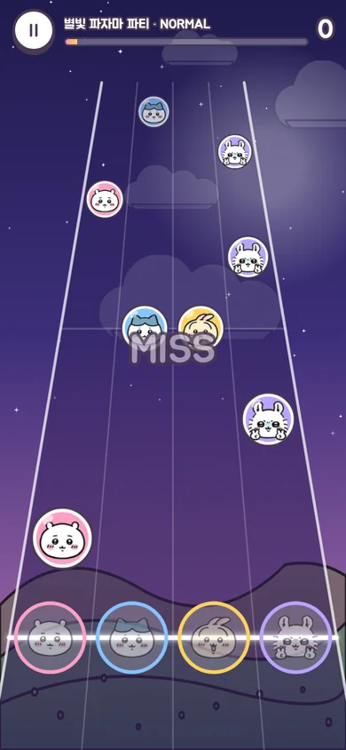
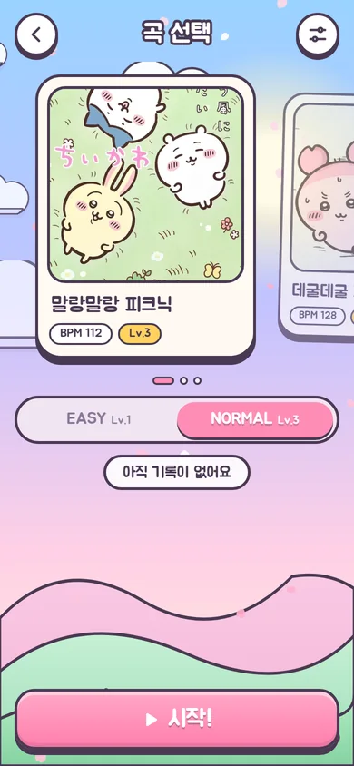
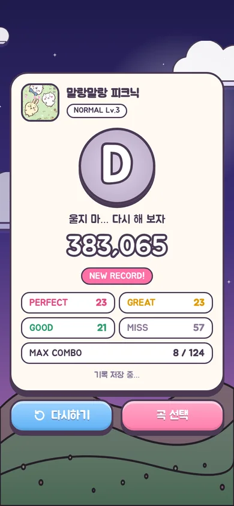

<div align="center">

# 먼작귀 리듬 파티

먼작귀 친구들과 함께 노트를 두드리는 **모바일 웹 리듬게임**

### [▶ 지금 플레이하기 — chaeminjae.vercel.app](https://chaeminjae.vercel.app)

  

</div>

## 주요 기능

- **움직이는 홈 화면** — 흐르는 구름, 떨어지는 벚꽃잎, 박자에 맞춰 통통 튀는 캐릭터. 배경을 이미지 대신 CSS · SVG · Canvas로 그려서 어떤 해상도에서도 선명해요.
- **4레인 리듬게임** — 원근감 있는 레인 위로 캐릭터 노트가 내려와요. PERFECT / GREAT / GOOD / MISS 판정, 콤보, 100만 점 만점 점수, S~D 랭크.
- **음원 파일 0개** — 세 곡 모두 Web Audio API로 브라우저에서 직접 합성해요. 멜로디 음 하나하나가 그대로 노트가 되기 때문에 박자가 어긋나지 않아요.
- **회원가입 / 로그인** — 닉네임 + 비밀번호, 프로필 캐릭터 32종 중 선택. 비밀번호는 scrypt로 해시하고, 세션은 HttpOnly 쿠키로 관리해요.
- **기록 저장 · 랭킹** — 곡·난이도별 최고 기록을 Postgres에 저장하고 TOP 30 랭킹으로 보여줘요. 게스트 기록은 그 기기에만 남아요.
- **모바일 최적화** — 멀티터치, 세로 화면, 노치(safe-area) 대응. 홈 화면에 추가하면 앱처럼 전체 화면으로 실행돼요. PC에서는 `D` `F` `J` `K` 키로 플레이.
- **설정** — 노트 속도, 싱크(오프셋) 조절, 로비 음악 · 타격음 켜기/끄기.

## 수록곡

| 곡 | BPM | EASY | NORMAL |
|---|---|---|---|
| 말랑말랑 피크닉 | 112 | Lv.1 | Lv.3 |
| 데굴데굴 퍼레이드 | 128 | Lv.2 | Lv.5 |
| 별빛 파자마 파티 | 150 | Lv.4 | Lv.8 |

## 스크린샷

| 회원가입 | 곡 선택 | 결과 |
|---|---|---|
|  |  |  |

## 기술 스택

| 영역 | 사용 기술 |
|---|---|
| 프론트엔드 | HTML · CSS · Vanilla JS (ES Modules), Canvas 2D, Web Audio API |
| 백엔드 | Vercel Functions (Node.js) |
| 데이터베이스 | Neon Postgres (Vercel Marketplace) |
| 배포 | Vercel |

빌드 도구나 프레임워크 없이 동작해요. 의존성은 `@neondatabase/serverless` 하나뿐이에요.

## 폴더 구조

```
├─ api/
│  └─ [action].js      # 모든 API (signup, login, logout, me, avatar, score, rank)
├─ public/
│  ├─ index.html       # 화면 마크업 (타이틀 · 로비 · 곡 선택 · 게임 · 결과 · 랭킹)
│  ├─ style.css        # UI 스타일 + 배경 애니메이션
│  ├─ app.js           # 화면 전환, 로그인, 결과 · 랭킹 UI, 배경 파티클
│  ├─ game.js          # 곡 데이터, 소리 합성, 채보 생성, 게임 엔진
│  └─ assets/          # 캐릭터 · 곡 자켓 · 프로필 이미지
├─ test/
│  └─ chart.test.js    # 곡 데이터 · 채보 · 판정 테스트
└─ docs/               # README 스크린샷
```

## 어떻게 동작하나요?

### 곡과 채보

곡은 `public/game.js` 안에 짧은 악보 문자열로 적혀 있어요.

```js
A: ['C|G|Am|F|C|G|F G|C',                  // 마디별 코드 진행
    'E5 - E5 G5 C6 - G5 - | D5 - D5 ...'],  // 한 마디 = 8칸, '-' 늘이기, '.' 쉼표
```

1. `OfflineAudioContext`로 멜로디(벨 소리) · 아르페지오 · 베이스 · 드럼을 한 번에 렌더링해요.
2. 같은 악보의 멜로디 음을 노트로 바꿔요. 음이 올라가면 오른쪽 레인, 내려가면 왼쪽 레인으로 가요.
3. EASY는 박 위의 음만, NORMAL은 모든 음에 두 마디마다 동시치기가 더해져요.

### 판정과 점수

| 판정 | 허용 오차 | 점수 비중 |
|---|---|---|
| PERFECT | ±45ms | 100% |
| GREAT | ±90ms | 70% |
| GOOD | ±135ms | 40% |

- 점수 = 1,000,000 × (판정 비중 합 ÷ 노트 수)
- 랭크: S 95만 · A 85만 · B 70만 · C 50만 이상, 나머지 D
- 게임 시각은 `AudioContext.getOutputTimestamp()`로 스피커에서 실제로 소리가 나는 시각에 맞춰요. 블루투스 이어폰처럼 지연이 큰 환경은 설정의 싱크 조절로 맞추면 돼요.

### API

| 메서드 | 경로 | 설명 |
|---|---|---|
| POST | `/api/signup` | 회원가입 `{ username, password, avatar }` |
| POST | `/api/login` | 로그인 `{ username, password }` |
| POST | `/api/logout` | 로그아웃 |
| GET | `/api/me` | 내 정보 + 곡별 최고 기록 |
| POST | `/api/avatar` | 프로필 캐릭터 변경 `{ avatar }` |
| POST | `/api/score` | 플레이 기록 저장 (최고 기록일 때만 갱신) |
| GET | `/api/rank?song=&diff=` | 곡 · 난이도별 TOP 30 |

### DB 테이블

| 테이블 | 내용 |
|---|---|
| `users` | 닉네임(UNIQUE), scrypt 비밀번호 해시, 프로필 번호, 플레이 횟수 |
| `sessions` | 세션 토큰의 SHA-256 해시, 만료 시각(30일) |
| `scores` | (사용자, 곡, 난이도)별 최고 점수 · 콤보 · 랭크 |

테이블은 첫 API 요청 때 자동으로 만들어져서 따로 마이그레이션할 필요가 없어요.

## 로컬에서 실행하기

```bash
npm install
npx vercel link        # Vercel 프로젝트 연결
npx vercel env pull    # DATABASE_URL 받아오기 (.env.local)
npx vercel dev         # http://localhost:3000
npm test               # 곡 데이터 · 채보 · 판정 테스트
```

## 배포

Vercel 프로젝트에 Marketplace의 Neon Postgres를 연결하면 `DATABASE_URL` 환경 변수가 자동으로 들어가요. 그다음 `main` 브랜치에 push하거나 `npx vercel deploy --prod`를 실행하면 끝이에요.

## 알려둘 점

- 점수는 클라이언트가 계산해서 보내는 값이라 서버에서는 범위만 검사해요. 랭킹은 친구끼리 즐기는 용도로 만들었어요.
- 캐릭터 이미지의 저작권은 원작자(나가노)에게 있으며, 이 프로젝트는 비상업적 팬메이드 작품이에요. 음악은 모두 직접 작곡해서 코드로 합성했어요.
