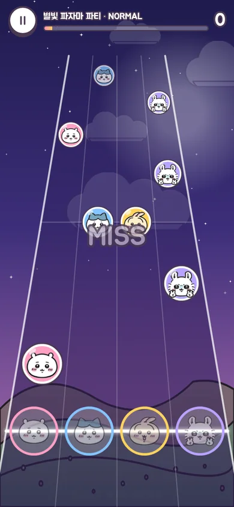

<div align="center">

# 먼작귀 리듬 파티

먼작귀 친구들과 누구나 아는 명곡을 신나게 연주하는 **모바일 웹 리듬게임**

### [▶ 지금 플레이하기 — chaeminjae.vercel.app](https://chaeminjae.vercel.app)

  

</div>

## v4.0.0 업데이트 (아래 예전 설명보다 이 내용이 우선)

- **137곡 · 장르 12개** — 저작권이 끝난 곡 + 이 게임용 창작곡. 같은 가락이 다시 나오면 다른 노트 모양 · 연타 대신 번갈아 치기로 덜 질리게.
- **멀티플레이 (PC · 휴대폰)** — 최대 10명 · 참가 코드 숫자 4자리 · **AI 넣기**(쉬움 · 보통 · 어려움 · 고수) · 연주 중 나오는 **아이템 노트**로 공격(☁️ 🌀 ⚡ 💣) · 1등이 다음 방장 · 방장 넘기기 · 내보내기 · 종합 순위판 · 30분 동안 연주가 없으면 방 닫힘 · 공격 키 변경. 체력이 0이 된 뒤에는 점수가 10%만 올라요.
- **친구** — 닉네임으로 신청 · 멀티 방 초대 · 무료 · 코인 · 보석 선물 · 공개 프로필.
- **플레이어 레벨 1000 · 테두리 101가지 · 레벨 혜택**, **캐릭터 레벨 업**(같은 카드 + 코인, 최대 20레벨 · 진화 대신), **초월 등급**(0.00000001%, 2명).
- **업적 약 5만 7천 개**(트랙마다 단계) · **상점 탭**(오늘의 카드 · 행운 상자 · 경험치 물약 · 새 부스터 4종) · **랭킹 기간 필터**(전체 · 30일 · 7일 · 오늘, 100위까지).
- **연주 안정화** — 입력 시각 보정(이벤트 timeStamp) · 시작 연타 잠금 · 곡 소리 캐시 3곡 제한 · 곡 합성은 Web Worker(`public/synth-worker.js`) · 그리기 에러가 나도 게임 계속 · 소리 멈춤 감지 · 일시정지 후 3·2·1 · 화면 에러는 관리자 페이지 '화면 에러'로 모아 봄.
- **PC 결과 화면 좌우 카카오 애드핏 160×600** (화면 폭 1180px 이상 · localhost에서는 안 뜸).

## 주요 기능

- **4레인 리듬게임** — 가로 2 : 세로 1 납작한 노트가 내려오면 판정선에 맞춰 누르기. 롱노트는 **끝까지 꾹 누르고 있어야** 인정, 동시치기, PERFECT / GREAT / GOOD / MISS + FAST · SLOW 표시, 콤보 50마다 팀 친구 응원.
- **난이도 8단계** — EASY · NORMAL · HARD · EXPERT · MASTER · EXTREME · INFERNO · CHAOS. EXTREME부터는 곡 자체가 1.1 · 1.15 · 1.25배 빨라져요. 레벨은 초당 노트 수로 자동 계산.
- **누구나 아는 곡 36곡** — 클래식 · 동요 · 민요 · 캐럴 (캉캉, 징글벨, 생일 축하합니다, 나비야, 윌리엄 텔 서곡 등). 모두 저작권이 끝난 곡을 드럼 · 베이스 넣어 신나게 편곡해서 브라우저에서 직접 합성 (음원 파일 0개, 곡당 0.1초).
- **경쟁** — 곡 · 난이도별 TOP 30과 내 순위, 종합 랭킹. **1~3위 시상대 · 내 순위 카드(상위 몇 % · 바로 위 순위까지 몇 점)** · 곡 고르기(장르별 목록 + 이전 · 다음) · 랭크 색 배지 · 최대 콤보 · 기록한 곡 수. 신기록을 세우면 축하 연출 + **내가 제친 사람들에게 "기록을 넘어섰어요" 우편**.
- **멀티플레이 (PC 전용)** — 홈 → 연주하기 → 멀티 플레이. **방 만들기**(참가 코드 5자리) · **참가하기**, 한 방 최대 6명(3×2 자리), 방장이 곡 · 난이도를 고르고 모두 **준비 완료**하면 시작. 게임 화면은 **가운데 내 화면 + 양옆 다른 참가자의 작은 화면(같은 채보 + 실시간 판정) · 순위표**. **30콤보마다 공격 1번**(최대 3번 모아 두기, Space로 발사 · 상대 화면을 눌러 목표 바꾸기): ☁️ 먹구름(위쪽 가리기) · 🌀 어질어질(흔들기) · ⚡ 번개 속도(노트가 빨라짐), 5초. 공평하게 팀 버프 · 부스터는 꺼지고, 체력이 0이 돼도 끝까지 연주(클리어만 실패). 보상 · 기록은 싱글과 같아요.
- **친구 50명 · 5등급 · 10단계 · 3차 진화** — 일반 60% · 희귀 25% · 영웅 12% · 전설 2.8% · 신화 0.2%. 계절 · 테마 의상 친구는 테마 배경과 소품으로 구분. 진화는 **성공 확률**(90 · 65 · 40%, 재료를 더 넣으면 1점마다 +1%, 실패하면 코인과 재료 절반이 사라짐).
- **팀 편성** — 카드를 꾹 눌러 끌어다 칸에 놓기(터치 · 마우스), 팀이 꽉 차면 **바꿀 친구 고르기 팝업**, 보유중 필터 · 정렬(파워 · 등급 · 단계 · 이름), 시너지 20종 자동 편성.
- **뽑기 배너 7종** — 기본 · 이번 주 픽업 · 시즌 축제 · 파자마 파티 · 밴드 콘서트 · 코인 뽑기 · 초보자 응원. 카드는 직접 눌러 뒤집고, 높은 등급은 뒷면이 반짝여요. **등급 확정 뽑기**: 고른 등급 이상이 나올 때까지 자동으로 한 장씩.
- **업적 1,231개 · 9개 분류** — 연주 · 곡별 · 실력 · 수집 · 캐릭터 · 성장 · 재화 · 출석 · 경쟁. MASTER 첫 클리어 축하금 보석 10,000개.
- **매일 보상** — **월간 출석부**(출석할수록 보상이 커지고 7 · 14 · 21 · 28일째 특별 보상), 오늘의 미션, 접속 시간 보상(5 · 15 · 30 · 60 · 120분).
- **상점 환전** — 같은 날 여러 번 바꿀수록 보석은 비싸지고 코인은 덜 줘요 (하루 횟수 제한 · 사고팔기를 반복하면 항상 손해라 돈 복사 불가).
- **우편함 · 공지사항 · 문의하기** — 가입 선물, 랭킹 알림, 관리자 선물, 문의 답장이 우편으로 (받은 우편은 지우기 가능). 홈의 공지사항에서 버전 · 날짜별 업데이트 내역. 문의 주제 7가지(노래 신청 · 오류 신고 · 건의 · 제안 · 보상 · 재화 · 계정 · 닉네임 · 유저 신고 · 기타).
- **곡 검색** — 연주 탭에서 제목 · 작곡가로 찾기 (초성도 돼요: ㅋㄴ → 캐논).
- **닉네임 변경** — 바꿀 때마다 코인 100,000개.
- **처음 가입하면 한 번** — 가입 축하 + 5장짜리 사용법.
- **설정** — 노트 속도, 싱크, 음악 · 효과음 크기, 타격음, **키보드 키 자유 변경**(기본 D F J K).
- **관리자 페이지** (`/admin/`) — 탭 5개 (휴대폰에서도 보기 좋게): **통계**(지금 접속 중 · 오늘 · 7일 / 30일 활성 · 재방문율 · 멀티 플레이 · 누적 숫자 카드와 어제 비교, 14일 추이, 요일 × 시간대 히트맵, 난이도별 · 곡별 플레이, 레벨 · 랭크 분포, 문의 주제, 등급별 캐릭터 보유, 명예의 전당) · **실시간**(지금 접속 중인 회원 · 게스트와 보고 있는 화면 · 기기 · 접속 시간, 열려 있는 멀티 방, 10초마다 새로) · **문의**(주제별 · 답변 상태별 · 검색, 자세히 보기(보낸 회원 레벨 · 플레이 · 가입일 · 다른 문의), 답변 + 선물, 주제 옮기기, 노래 신청 순위) · **운영**(서버 점검 모드 + 사유 + 관리자 미리보기, **점검 예고 팝업**, 받는 사람 골라 우편 보내기, 공지사항 쓰기 · 고치기, **뽑기 확률 조정**) · **회원 · 기록**(최근 플레이 새로고침, 회원 목록, 곡별 통계).
- **점검 모드** — 켜면 30초 안에 모든 화면(게스트 포함)이 막혀요. 게임 중이면 곡이 끝난 뒤에. 관리자는 미리보기를 켠 브라우저만 들어갈 수 있어요.
- **모바일 최적화** — 세로 화면 전용 구성(창은 아래에서 올라오는 시트), 멀티터치, 노치 대응, 화면을 벗어나면 소리를 끔. PC는 가로 화면 구성(큰 화면은 통째로 확대).
- **광고** — 홈 화면 아래 카카오 애드핏 (PC 728×90 · 모바일 320×100).

## 수록곡

| 곡 | 원곡 | 장르 | 길이 | 레벨 (EASY · NORMAL · HARD · EXPERT · MASTER · EXTREME · INFERNO · CHAOS) | 가격 |
|---|---|---|---|---|---|
| 작은 별 변주곡 | 모차르트 | 클래식 | 1:00 | 2 · 4 · 4 · 5 · 8 · 13 · 14 · 15 | 무료 |
| 징글벨 | 피어폰트 | 캐럴 | 1:13 | 3 · 4 · 5 · 6 · 12 · 13 · 14 · 15 | 무료 |
| 성자의 행진 | 미국 민요 | 민요 · 포크 | 0:48 | 2 · 3 · 3 · 4 · 12 · 13 · 14 · 15 | 무료 |
| 라 쿠카라차 | 멕시코 민요 | 민요 · 포크 | 0:42 | 3 · 5 · 5 · 6 · 11 · 12 · 14 · 15 | 무료 |
| 환희의 송가 | 베토벤 | 클래식 | 1:08 | 3 · 3 · 4 · 5 · 10 · 11 · 12 · 13 | 무료 |
| 귀향 (신세계 교향곡) | 드보르자크 | 클래식 | 1:00 | 1 · 2 · 2 · 2 · 5 · 9 · 11 · 12 | 무료 |
| 미뉴에트 G장조 | 바흐 | 클래식 | 0:49 | 3 · 5 · 6 · 7 · 10 · 11 · 12 · 14 | 무료 |
| 코로베이니키 | 러시아 민요 | 민요 · 포크 | 1:05 | 3 · 5 · 5 · 7 · 12 · 13 · 14 · 15 | 1,500 코인 |
| 캐논 | 파헬벨 | 클래식 | 0:54 | 2 · 4 · 4 · 5 · 7 · 12 · 13 · 14 | 1,000 코인 |
| 엘리제를 위하여 | 베토벤 | 클래식 | 0:38 | 2 · 6 · 7 · 9 · 10 · 11 · 13 · 15 | 1,500 코인 |
| 터키 행진곡 | 모차르트 | 클래식 | 0:47 | 3 · 6 · 10 · 12 · 14 · 15 · 16 · 20 | 2,000 코인 |
| 교향곡 40번 | 모차르트 | 클래식 | 0:41 | 3 · 5 · 6 · 7 · 12 · 13 · 14 · 15 | 2,000 코인 |
| 프렐류드 C장조 | 바흐 | 클래식 | 0:47 | 3 · 7 · 7 · 8 · 11 · 12 · 13 · 16 | 2,500 코인 |
| 캉캉 (천국과 지옥) | 오펜바흐 | 클래식 | 0:35 | 4 · 8 · 12 · 14 · 16 · 17 · 18 · 24 | 3,000 코인 |
| 토카타와 푸가 d단조 | 바흐 | 클래식 | 1:01 | 3 · 5 · 6 · 6 · 9 · 10 · 11 · 14 | 3,500 코인 |
| 산왕의 궁전에서 | 그리그 | 클래식 | 0:56 | 3 · 7 · 7 · 9 · 12 · 13 · 14 · 16 | 5,000 코인 |
| 생일 축하합니다 | 힐 자매 | 동요 | 0:29 | 4 · 5 · 6 · 6 · 13 · 14 · 15 · 16 | 무료 |
| 나비야 | 독일 민요 | 동요 | 0:57 | 3 · 3 · 4 · 5 · 11 · 12 · 13 · 14 | 무료 |
| 머리 어깨 무릎 발 (런던 다리) | 영국 민요 | 동요 | 0:40 | 4 · 6 · 7 · 8 · 12 · 13 · 14 · 16 | 무료 |
| 떴다 떴다 비행기 (메리의 어린 양) | 미국 민요 | 동요 | 0:37 | 3 · 4 · 5 · 6 · 12 · 13 · 14 · 15 | 무료 |
| 맥도날드 할아버지 | 미국 민요 | 동요 | 0:50 | 3 · 4 · 5 · 6 · 12 · 13 · 14 · 15 | 무료 |
| 핫 크로스 번 | 영국 민요 | 동요 | 0:48 | 3 · 5 · 6 · 7 · 12 · 13 · 14 · 15 | 무료 |
| 자크 형제 (프레르 자크) | 프랑스 민요 | 동요 | 0:37 | 4 · 5 · 6 · 7 · 13 · 14 · 15 · 16 | 무료 |
| 노를 저어라 (로 로 로 유어 보트) | 미국 민요 | 동요 | 0:36 | 3 · 6 · 7 · 9 · 12 · 13 · 14 · 16 | 무료 |
| 위 위시 유 어 메리 크리스마스 | 영국 캐럴 | 캐럴 | 0:37 | 4 · 6 · 7 · 8 · 13 · 14 · 15 · 16 | 무료 |
| 덱 더 홀스 | 웨일스 캐럴 | 캐럴 | 0:48 | 3 · 5 · 6 · 7 · 12 · 13 · 14 · 15 | 500 코인 |
| 고요한 밤 (로파이) | 그루버 | 캐럴 | 0:44 | 3 · 6 · 7 · 8 · 11 · 12 · 13 · 16 | 500 코인 |
| 양키 두들 | 미국 민요 | 민요 · 포크 | 0:35 | 4 · 8 · 9 · 10 · 13 · 14 · 15 · 17 | 500 코인 |
| 오! 수재너 | 포스터 | 민요 · 포크 | 0:39 | 4 · 7 · 8 · 9 · 13 · 14 · 15 · 17 | 800 코인 |
| 클레멘타인 | 미국 민요 | 민요 · 포크 | 0:31 | 2 · 6 · 6 · 8 · 12 · 13 · 14 · 16 | 800 코인 |
| 석별의 정 (올드 랭 사인) | 스코틀랜드 민요 | 민요 · 포크 | 0:45 | 2 · 3 · 4 · 5 · 10 · 11 · 13 · 14 | 1,000 코인 |
| 어메이징 그레이스 | 미국 민요 | 민요 · 포크 | 0:43 | 2 · 3 · 4 · 4 · 10 · 11 · 13 · 14 | 1,000 코인 |
| 그린슬리브스 | 영국 민요 | 민요 · 포크 | 0:40 | 2 · 4 · 5 · 6 · 11 · 12 · 14 · 15 | 1,500 코인 |
| 종달새 (알루에트) | 프랑스 민요 | 민요 · 포크 | 0:48 | 3 · 6 · 6 · 8 · 12 · 13 · 14 · 16 | 1,000 코인 |
| 윌리엄 텔 서곡 | 로시니 | 클래식 | 0:39 | 3 · 8 · 10 · 13 · 15 · 16 · 17 · 23 | 2,500 코인 |
| 운명 교향곡 (리믹스) | 베토벤 | 클래식 | 0:45 | 2 · 4 · 4 · 7 · 12 · 13 · 16 · 18 | 3,000 코인 |

### 최신 노래는 왜 없나요?

요즘 노래는 작곡 · 작사 저작권(한국음악저작권협회)과 음원 저작인접권(기획사 · 음반사)이 모두 살아 있어서, 웹에 올려 누구나 듣게 하면 둘 다 허락(라이선스)을 받아야 해요. 그래서 이 게임은 저작권이 끝난 곡(작곡가 사후 70년)과 작자 미상 민요만 넣었어요. 쓸 수 있는 방법은 이 정도예요.

1. **저작권이 끝난 유명곡을 신나게 편곡** (지금 방식) — 비용 0, 바로 가능.
2. **직접 만들었거나 게임 사용이 허락된 음원** — 파일을 주면 BPM을 분석해 채보를 만들어 넣을 수 있어요.
3. **정식 라이선스** — 최신 곡을 넣는 유일한 합법적인 방법. 곡마다 비용과 계약이 필요해요.

유저가 문의하기 → 노래 신청으로 보낸 곡은 관리자 페이지 '노래 신청 순위'에 모여요.

## 기술 스택

| 영역 | 사용 기술 |
|---|---|
| 프론트엔드 | HTML · CSS · Vanilla JS (ES Modules), Canvas 2D, Web Audio API |
| 백엔드 | Vercel Functions (Node.js) |
| 데이터베이스 | Neon Postgres (Vercel Marketplace) |
| 배포 | Vercel |

빌드 도구나 프레임워크 없이 동작해요. 의존성은 `@neondatabase/serverless` 하나뿐이에요.

## 폴더 구조

```
├─ api/
│  └─ [action].js      # 모든 API (회원 · 게임 · 랭킹 · 우편 · 문의 · 공지 · 점검 · 관리자)
├─ public/
│  ├─ index.html       # 화면 마크업
│  ├─ style.css        # UI 스타일 (모바일 세로 / PC 가로 구성) + 배경 애니메이션
│  ├─ app.js           # 화면 전환, 로그인, 사용법, 팀(끌어서 장착), 진화, 뽑기, 출석부, 업적, 우편함, 공지, 문의, 결과, 랭킹, 설정, 광고, 멀티플레이
│  ├─ game.js          # 게임 엔진(+ 멀티 방해 효과 · 다른 참가자 작은 화면), 곡 합성(멜로디 · 반주 · 베이스 · 드럼), 타격음, 캐릭터 목소리
│  ├─ songs.js         # 곡 악보, 난이도 8단계 채보 생성, 빨라진 곡, 레벨 계산, 곡 검색(초성)
│  ├─ rules.js         # 게임 규칙 (서버 · 브라우저 공용): 캐릭터, 뽑기, 진화, 환전, 출석, 업적, 미션, 보상, 문의 주제, 멀티(순위 · 공격 목표), 버전
│  ├─ admin/index.html # 관리자 페이지
│  └─ assets/          # 캐릭터 · 곡 자켓 · 프로필 이미지
├─ test/
│  └─ chart.test.js    # 곡 · 채보 · 판정 · 게임 규칙 · 곡 검색 · 멀티 순위 · 예전 저장 데이터 호환 테스트
└─ docs/               # README 스크린샷
```

## 어떻게 동작하나요?

### 곡과 채보

곡은 `public/songs.js` 안에 짧은 악보 문자열로 적혀 있어요.

```js
A: ['C|C|G7|C G7',                            // 마디별 코드 진행
    'C5 - - - D5 F5 E5 D5 | G5 - G5 - ...'],  // '-' 늘이기, '.' 쉼표
```

1. 같은 악보로 멜로디 · 반주 · 신스 베이스 · 드럼을 자바스크립트로 직접 합성해요 (곡당 약 0.1초).
2. 멜로디 음을 노트로 바꿔요. 음이 올라가면 오른쪽 레인, 내려가면 왼쪽 레인.
3. 난이도마다 노트 간격 · 동시치기 · 반주 박자 노트를 다르게 넣고, EXTREME부터는 곡을 빠르게 해서, 초당 노트 수로 레벨을 계산해요.

### 판정과 점수

| 판정 | 허용 오차 | 점수 비중 |
|---|---|---|
| PERFECT | ±50ms | 100% |
| GREAT | ±100ms | 70% |
| GOOD | ±150ms | 40% |

- 점수 = 1,000,000 × (판정 비중 합 ÷ 노트 수) × (1 + 팀 버프의 '점수 +%')
- 랭크: S 95만 · A 85만 · B 70만 · C 50만 이상, 나머지 D

### 카드 점수 · 진화

- 카드 점수 = 등급 기본 점수(일반 100 · 희귀 180 · 영웅 320 · 전설 560 · 신화 1,000) × (1 + 단계당 15%) × (1 + 진화당 30%)
- 팀 점수 = 팀 카드 점수 합 × (1 + 시너지 개수 × 10%)
- 진화 1 · 2 · 3차: 3 · 6 · 10단계 이상 + 재료 점수 10 · 30 · 80 + 코인, 성공 확률 90 · 65 · 40%. 재료는 다른 친구의 남는 카드(일반 1 · 희귀 3 · 영웅 8 · 전설 20 · 신화 50점), 필요한 점수를 넘긴 1점마다 확률 +1%. 실패하면 코인과 넣은 재료 절반이 사라져요. 진화할 때마다 버프 +25%.

### API

| 메서드 | 경로 | 설명 |
|---|---|---|
| POST | `/api/signup` · `/api/login` · `/api/logout` | 회원가입 · 로그인 · 로그아웃 |
| GET | `/api/me` | 내 정보 + 저장 데이터 + 안 읽은 우편 수 |
| POST | `/api/rename` | 닉네임 변경 (코인 100,000개) |
| POST | `/api/act` | 재화가 바뀌는 모든 행동 (뽑기, 진화, 팀, 구매, 업적, 미션, 접속 보상, 플레이 결과 …) |
| GET | `/api/rank?song=&diff=` · `/api/rank-total` | 곡별 TOP 30 + 내 순위 · 종합 랭킹 |
| GET · POST | `/api/mail` · `/api/mail-read` · `/api/mail-claim` · `/api/mail-delete` | 우편함 (받기 · 지우기) |
| POST · GET | `/api/inquiry` · `/api/inquiries` | 문의 보내기 · 내 문의 |
| GET | `/api/notices` | 공지사항 (버전 · 날짜별 업데이트 내역) |
| GET | `/api/status?v=&s=&d=` | 점검 모드 · 점검 예고 · 뽑기 확률 · 버전 + 지금 접속 중 신호 (모든 화면이 30초마다) |
| POST | `/api/mp-create` · `/api/mp-join` · `/api/mp-leave` | 멀티 방 만들기 (참가 코드) · 참가 · 나가기 |
| POST | `/api/mp-set` · `/api/mp-ready` · `/api/mp-start` · `/api/mp-kick` | 곡 · 난이도 고르기(방장) · 준비 · 시작(방장, 5초 뒤 다 같이) · 내보내기(방장) |
| POST | `/api/mp-sync` | 대기 2초 · 게임 중 0.35초마다: 내 점수 · 콤보 · 판정 · 공격 · 결과 올리기 + 방 상태 받기 |
| POST · GET | `/api/admin-*` | 관리자: 로그인, 통계 · 명예의 전당, 지금 접속 중 · 멀티 방, 최근 플레이, 점검 모드 · 미리보기, 점검 예고, 뽑기 확률, 우편 보내기, 공지 쓰기 · 고치기 · 지우기, 문의함 · 주제 옮기기, 답변 |

### DB 테이블

| 테이블 | 내용 |
|---|---|
| `users` | 닉네임(UNIQUE), scrypt 비밀번호 해시, 프로필 번호, 저장 데이터(JSONB) |
| `sessions` · `admin_sessions` | 세션 토큰의 SHA-256 해시, 만료 시각 |
| `scores` | (사용자, 곡, 난이도)별 최고 점수 · 콤보 · 랭크 |
| `play_log` | 모든 플레이 기록 (통계용 · 멀티 여부) |
| `mail` | 우편 (가입 선물 · 랭킹 알림 · 관리자 선물 · 문의 답장) |
| `inquiries` | 문의 (주제 7가지) |
| `presence` | 지금 접속 중 (기기마다 임의 번호 · 회원 · 지금 화면 · 기기 · 마지막 신호) |
| `rooms` · `room_players` · `room_events` | 멀티 방(참가 코드 · 방장 · 곡 · 판 번호 · 시작 시각) · 참가자(자리 0~5 · 준비 · 실시간 상태 · 결과) · 공격 |
| `app_settings` | 점검 모드 · 점검 예고 · 뽑기 확률 같은 사이트 설정 |
| `notices` | 공지사항 (버전 · 제목 · 내용) |

테이블은 첫 API 요청 때 자동으로 만들어져요. 새 기능은 새 테이블만 더하고 기존 회원 데이터는 그대로 이어서 써요.

## 로컬에서 실행하기

```bash
npm install
npx vercel link        # Vercel 프로젝트 연결
npx vercel env pull    # DATABASE_URL 받아오기 (.env.local)
npx vercel dev         # http://localhost:3000
npm test               # 곡 · 채보 · 판정 · 게임 규칙 테스트
```

## 배포

Vercel 프로젝트에 Marketplace의 Neon Postgres를 연결하면 `DATABASE_URL` 환경 변수가 자동으로 들어가요. 관리자 계정은 `ADMIN_USER` · `ADMIN_PASSWORD` 환경 변수로 정해요. 그다음 `npx vercel deploy --prod`를 실행하면 끝이에요. 작업 중에는 관리자 페이지에서 점검 모드를 켜 두고, 미리 알리고 싶으면 점검 예고를 보내세요. 버전(`public/rules.js`의 `VERSION`)을 올려 배포하면 열려 있던 화면들이 한 번 새로고침돼요.

## 알려둘 점

- 점수는 클라이언트가 계산해서 보내는 값이라 서버에서는 범위만 검사해요. 랭킹은 친구끼리 즐기는 용도로 만들었어요.
- 멀티플레이는 실시간 서버 없이 Postgres와 짧은 폴링(게임 중 0.35초)으로 동작해요. 방이 많아져 DB가 바빠지면 WebSocket 서비스로 옮기면 돼요. 다른 참가자의 작은 화면은 같은 채보를 내 화면에서 그리고 받은 판정만 표시해서, 실제보다 0.6초 늦게 보여요.
- 캐릭터 이미지의 저작권은 원작자(나가노)에게 있으며, 이 프로젝트는 비상업적 팬메이드 작품이에요. 무대 · 계절 · 테마 의상 친구들은 원래 친구 그림에 테마 배경과 소품 배지를 붙인 버전이에요 (새 그림이 생기면 `public/assets/cards/`에 넣고 `rules.js`의 `card`로 연결하면 돼요).
- 수록곡은 모두 저작권이 끝난 클래식 · 민요를 직접 편곡해서 코드로 합성했어요.
